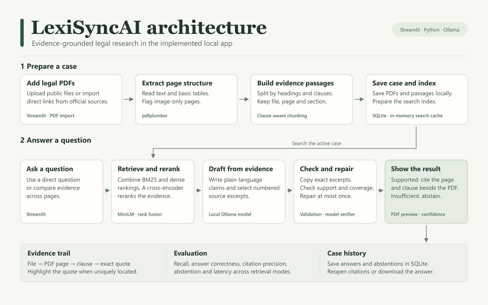

# LexiSyncAI

LexiSyncAI answers questions about public legal PDFs. Each supported claim links to an exact quote, a clause or section, and the original PDF page. When the evidence is insufficient, the app abstains and lists the documents it searched.

## Contents

- [Features](#features)
- [Architecture](#architecture)
- [Technology used](#technology-used)
- [Run on Windows](#run-on-windows)
- [Use the app](#use-the-app)
- [Evaluation](#evaluation)
  - [Results at a glance](#results-at-a-glance)
- [Assignment materials](#assignment-materials)
- [Known limitations](#known-limitations)

## Features

| Feature | What it does |
|---|---|
| PDF uploads and official links | Mix local files and supported direct HTTPS PDF links, up to five documents per case. |
| Scanned-page OCR | On Windows, optionally recognize image-only pages. OCR citations are labeled so readers can compare the transcription with the original image. |
| Document structure | Extracts text and ruled tables with merged cell context, identifies numbered headings and clauses, and flags image-only pages. |
| Figure review | Sends a selected page to a local vision model and displays the original alongside its experimental interpretation. |
| Hybrid evidence search | Combines BM25 and dense embeddings, reranks candidates, and prioritizes explicit article or section references when matched. |
| Cited answers | Generates plain-language claims from retrieved passages and attaches exact source excerpts. Click a citation to open its PDF page and highlight the quote when uniquely located. |
| Verification and abstention | Checks citation integrity and evidence support, allows at most one repair attempt, and abstains when support is insufficient. |
| Historical version comparison | For an explicit section and amendment question, checks whether a cited amendment note explains a wording change between two editions. |
| Saved cases and exports | Reopen cases and earlier answers, including abstentions. Download a text record with citations and available official source links. |
| Case citation audit | Download a CSV covering all saved answers in a case, with cited claims, exact excerpts, PDF locations, source links, and abstentions. |
| Analysis details | Shows timing, Ollama token counts, and available repair traces. |
| Reproducible evaluation | Compares BM25, dense retrieval, fusion, and reranked hybrid retrieval. Includes graded outputs for the copyright and held-out GDPR question sets. |

## Architecture

[](architecture.svg)

**Case preparation.** The app imports or uploads PDFs, extracts structure and searchable passages, and stores the originals with their file, page, and clause metadata. Search indexes are prepared from the saved passages and cached in memory.

**Question answering.** Reciprocal rank fusion combines the keyword and dense rankings. A cross-encoder reranks the candidates. Ollama drafts claims by selecting numbered excerpts, which the app resolves to exact text. A verifier checks support and coverage. The app saves either the cited answer or an abstention to case history.

See the [scalable diagram](architecture.svg) and [architecture notes](ARCHITECTURE.md). The notes describe a future Vercel Workflow extension separately from the implemented local app.

## Technology used

| Layer | Technology | Role |
|---|---|---|
| Interface | Streamlit, CSS | Case management, question entry, and side-by-side evidence review |
| Application | Python 3.11 or 3.12 | PDF intake, evidence search, verification, and evaluation |
| PDF handling | pdfplumber, PDFium via pypdfium2, Pillow | Text and table extraction, PDF rendering, and quote highlighting |
| Optional OCR | Windows.Media.Ocr | Recognizes image-only pages using installed Windows language resources |
| Keyword retrieval | BM25 via rank-bm25 | Finds literal terms and identifiers such as clause numbers |
| Dense retrieval | Sentence Transformers, all-MiniLM-L6-v2, NumPy | Finds passages with related meaning |
| Reranking | Reciprocal rank fusion, MS MARCO MiniLM cross-encoder | Combines rankings and scores question–passage pairs |
| Local generation | Ollama, Qwen3-4B-Instruct default | Drafts answers and checks evidence support |
| Local storage | SQLite | Saves cases, PDFs, passages, source links, and answer history |
| Setup and validation | Windows launcher, Docker Compose, Python unittest | Runs the app and checks core behavior |

## Run on Windows

Install Python 3.11 or 3.12 and Ollama on a fresh Windows machine. Double-click **Launch LexiSyncAI.cmd** and keep the launcher window open. The launcher prepares dependencies and the local language model when needed. The retrieval models download on the first indexing run.

### Manual setup

Start Ollama and run `ollama pull kamekichi128/qwen3-4b-instruct-2507:latest`. Set `OLLAMA_MODEL` if you use another instruction model that supports JSON responses.

```powershell
py -3.11 -m venv .venv
.\.venv\Scripts\python.exe -m pip install -r requirements.txt
.\.venv\Scripts\python.exe -m streamlit run app.py
```

Open the local address printed in the terminal.

### Docker

With Docker Desktop and Ollama running on the host, run `docker compose up --build`. The container reaches Ollama at `host.docker.internal` and mounts a persistent case-data volume.

The [Docker verification workflow](https://github.com/hitesh175/LexiSyncAI/actions/workflows/docker-verification.yml) builds and starts the app on a GitHub-hosted Linux runner, checks the running server, and verifies the exact §107(2) answer and PDF preview inside the container. That workflow exercises the direct PDF lookup. Model-generated answers use a separate Ollama service.

## Use the app

1. Select **Add a new case**, choose your PDFs, and select **Save documents**. The case name is optional. A single PDF is supported for the unseen-document exam.
2. To import from a link, expand **Use official PDF links instead** and paste one direct HTTPS PDF link per line. Supported publishers include EUR-Lex, EDPB, GovInfo, UK legislation, and selected German federal publishers. Linked PDFs have a 25 MB limit. If a publisher blocks downloads, save its PDF and upload it.
3. Enter a question and select **Get answer**. Select a numbered source to see the exact quote and original PDF page.
4. Use **Documents** to inspect the files and detected page structure. Use **Previous answers** to reopen an answer and **Download answer and citations** to export it.
5. Under **Previous answers**, choose **Download case citation audit (CSV)** to review the entire case in a spreadsheet.

For image-only PDFs, turn on **Read scanned pages (OCR)** before saving. It uses Windows OCR with the language resources installed on the device. Pages with unavailable or failed OCR remain flagged and are excluded from text search. A case with no searchable pages displays a setup message. OCR-derived quotes are marked in the preview and export.

For figures, run `ollama pull qwen2.5vl:3b` once, then choose **Documents → Ask about a chart or figure**. Pick a file and PDF page, enter a question and compare the response with the page. Set `OLLAMA_VISION_MODEL` to use a different local vision model. Figure interpretations are shown separately from verified text answers.

Cases are stored in `.lexisync/cases.sqlite3`. Back up this file while the app is closed. Set `LEXISYNC_CASE_DB` to change the location. The app keeps up to four prepared indexes in memory until restart and asks Ollama to keep its model loaded for 30 minutes.

## Evaluation

```powershell
.\.venv\Scripts\python.exe -m unittest -v
.\.venv\Scripts\python.exe evaluate.py
```

The default evaluation runs the 15-question copyright fixture against the two GovInfo PDFs in `data/`. The separate 15-question GDPR fixture uses the regulation and EDPB breach guidance included in this repository. Each fixture contains factual, multi-page, and unanswerable questions.

Use `--retrieval-only` to skip generation. The evaluator reports recall at 1, 5, and 10 for the four retrieval configurations and measures answer time and abstention for dense and hybrid. The review sheets separate factual answer correctness from whether each citation supports its claim. The [benchmark report](RESULTS.md) includes the GDPR reproduction command, measured results, and known failure examples.

### Results at a glance

The table summarizes the multipart retrieval rerun on the 15-question GDPR fixture. Correct answers include correct abstentions. Response time is measured after index preparation.

| Metric | Dense | Reranked hybrid |
|---|---:|---:|
| Annotated evidence recall at 10 | 62.5% | **100.0%** |
| Correct answers | 9/15 | **12/15** |
| Citation precision | 61.5% (16/26) | **88.0% (22/25)** |
| Correct abstentions on unanswerable questions | 3/3 | 3/3 |
| False abstentions on answerable questions | 2/12 | 2/12 |
| Mean response time | **5.27 s** | 5.46 s |

Hybrid citation precision rose from 86.7% to 88.0% compared with the earlier run on the same fixture, while answer correctness fell from 13/15 to 12/15. The separate quote-highlight sample produced **9 correct highlights, 0 wrong highlights, and 1 full-page fallback** for a repeated quote. See the [benchmark report](RESULTS.md#multipart-evidence-and-citation-region-evaluation) for methodology, build details, and failure cases.

The [merged table evaluation](RESULTS.md#merged-table-evaluation) matched values, row labels, and column labels for all 18 manually checked cells across three EDPB tables.

The Windows OCR sample produced **1.00% aggregate word error** on three clean rasterized legal pages. See the [OCR evaluation](RESULTS.md#scanned-page-ocr-evaluation) for the sample, fallback, and limitations.

## Assignment materials

The four numbered EU GDPR PDFs in the repository root form the GDPR source pack. The copyright sample PDFs come from the 2023 U.S. Code. [Section 106](https://www.govinfo.gov/content/pkg/USCODE-2023-title17/pdf/USCODE-2023-title17-chap1-sec106.pdf) · [Section 107](https://www.govinfo.gov/content/pkg/USCODE-2023-title17/pdf/USCODE-2023-title17-chap1-sec107.pdf)

## Known limitations

- Extraction uses layout heuristics. Complex columns, footnotes, and spanning tables may need manual review. Image-only pages remain flagged and are searchable only when OCR succeeds.
- Exact quotes can still be misinterpreted. Confidence labels describe the verifier’s judgment and are uncalibrated.
- The benchmark results describe the recorded fixtures. See [Results](RESULTS.md) for the build and conditions of each run.
